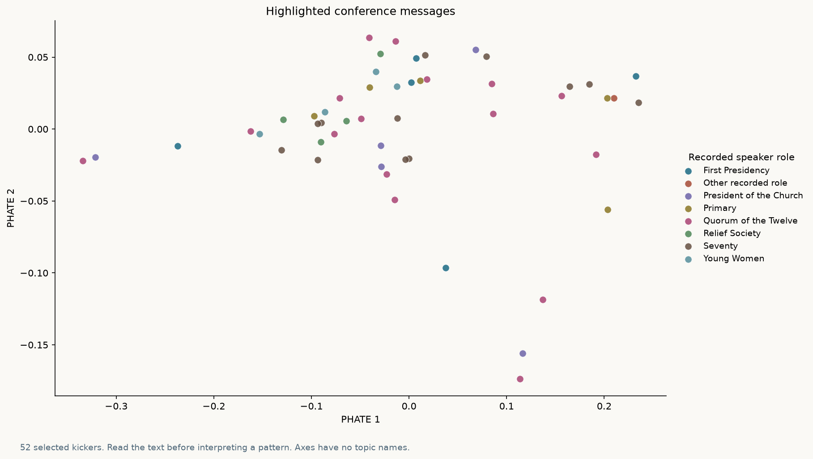

## Warm-up: our existing Plotly figure

Our published conference map already supports hover, zoom, and legend interaction.

With a partner:

1. What can a reader investigate without running Python?
2. What would still require changing our notebook?

::: {.notes}
Allow 90 seconds. Hover shows source metadata, zoom changes the view, and legend clicks show or hide traces. New pandas filters, new summary calculations, and new model computations require executable analysis or additional precomputed browser logic. Connect this to the earlier Plotly publishing lesson.
:::

## Today's question

> How can someone explore our analysis without becoming a Python programmer?

We will identify a useful task, choose an interface, and trace the Python code behind it.

## A real task for our explorer

You are preparing a lesson and remember a message about helping others.

- Find several messages worth reading.
- Compare who gave them and when.
- Follow the source links to check their full context.

::: {.notes}
Open the completed app. Spend two minutes showing one concrete path: text filter, read a kicker, open the source, then broaden the view. Avoid touring every control.
:::

## The map guides a closer reading

{height=440 fig-alt="PHATE scatterplot of 52 Nomic kicker embeddings, colored by recorded speaker role."}

The app connects this view to filters, summary counts, and the actual messages.

## Reproducibility and access

Our existing workflow preserves data, processing steps, code, and model outputs.

An app adds a guided interface to those same steps.

The reader chooses inputs. Our Python code performs the analysis consistently.

## The value of a dashboard

| Situation | Useful result |
|---|---|
| Repeated questions | A person can answer the next variation independently |
| Different groups or time windows | Controls expose relevant comparisons |
| A pattern needs explanation | The reader can inspect supporting records |
| A recurring decision | The relevant evidence is easy to revisit |

## Choosing the right format

| Need | A reasonable starting point |
|---|---|
| Communicate one finding | A labeled figure and a short explanation |
| Explain a complete argument | A report or website |
| Develop or audit an analysis | A notebook |
| Explore recurring variations | An interactive app |

Different formats can support the same project.

## Think, pair, share: does this need an app?

1. A classmate needs one figure for tomorrow's presentation.
2. A librarian repeatedly compares use across branches and dates.
3. A researcher wants to inspect model outputs and their source records.

Choose one. What would an app make easier? What would you ask the user first?

::: {.notes}
Allow two minutes. A dashboard has development and maintenance costs. Cases 2 and 3 have plausible recurring interaction. In case 1, a clear figure is likely sufficient. Accept alternatives supported by a specific user task.
:::

## Five design questions

| Question | Conference example |
|---|---|
| Who is using it? | Someone preparing a lesson |
| What do they need? | Relevant messages and supporting context |
| What evidence helps? | Kickers, metadata, and original talks |
| Which choices matter? | Years, speakers, and text filters |
| What builds trust? | Source links and clear sample limitations |

## Compare two interfaces

::: {.columns}
::: {.column width="48%"}
### Interface A

"Conference Dashboard"

- A large unlabeled map
- Eight controls with unfamiliar names
- A total with no explanation
- Text hidden behind point numbers
:::
::: {.column width="48%"}
### Interface B

"Explore highlighted messages"

- A short purpose statement
- Years and speakers in plain language
- "36 of 52 talks displayed"
- Kickers and original source links
:::
:::

Which interface helps our user complete the task? Why?

## Metrics provide context

After filtering to 2023 and later:

| Summary | Value |
|---|---:|
| Talks displayed | 36 of 52 |
| Speakers represented | 28 |
| Conferences represented | 4 |

What does each number help us interpret? Which additional metric would help a particular question?

::: {.notes}
These values come from the supplied CSV. An extra metric needs a purpose. Avoid inventing an average embedding coordinate or a cluster count for decoration.
:::

## Visual choices support the task

- Place the question and useful evidence early.
- Choose defaults that show a meaningful view.
- Use readable labels and consistent colors.
- Pair visual summaries with accessible text or a table.
- Explain empty selections and missing results.

## Trust includes the denominator

These data contain 52 **selected kickers** from six conferences.

Each kicker represents a highlighted message before a talk.

Counts describe the displayed sample. They cannot establish historical trends across the entire archive.

## Why Streamlit fits this course

We can reuse pandas transformations and existing Plotly figures.

A widget returns a Python value. We use that value in our analysis, then display the result.

The application supplies the browser interface without requiring us to write its HTML or JavaScript.

::: {.notes}
Streamlit documentation: https://docs.streamlit.io/get-started/fundamentals/main-concepts . Frame this as a good match for Python data apps. More customized web workflows may justify other frameworks.
:::

## Plotly and Streamlit

| Plotly | Streamlit |
|---|---|
| Builds the figure | Builds the surrounding application |
| Provides hover, pan, and zoom | Collects inputs and executes Python |
| Can export a standalone HTML plot | Can connect plots, summaries, and records |

Our app displays a Plotly figure using `st.plotly_chart(fig)`.

## The browser and the Python server

| Component | Responsibility |
|---|---|
| Browser | Displays the interface and sends input changes |
| Python server | Runs our script, reads data, and computes results |
| Local development | Both run on our computer |
| Hosted app | The server runs on the host, while the reader uses a browser |

::: {.notes}
Source: https://docs.streamlit.io/develop/concepts/architecture/architecture . A hosted app cannot automatically read the reader's disk or call Ollama on the instructor's laptop.
:::

## Launching an app with uv

From the project folder:

```bash
uv sync
uv run streamlit run day1/01_basic.py
```

`uv` uses the project environment. `streamlit run` starts the application server.

Leave the terminal running. Press **Ctrl+C** there to stop the server.

## A minimal app

```python
import streamlit as st

st.title("Explore conference messages")
year = st.select_slider(
    "Earliest conference year",
    options=[2020, 2023, 2025], value=2020,
)
st.write("Include conferences from", year)
```

The widget returns a value we can use in Python.

## The default execution model

1. Run the script from top to bottom.
2. Display the Streamlit elements in the browser.
3. A widget change sends an updated value to the server.
4. Run the script again with that value.

This describes our basic apps. Forms and other features can change when or how much code reruns.

::: {.notes}
Source: https://docs.streamlit.io/get-started/fundamentals/summary . A Plotly hover or zoom does not automatically trigger this Python cycle.
:::

## Predict the next run

```python
print("START")
count = 0
name = st.text_input("Your name", "Ada")
if st.button("Add one"):
    count += 1
st.write(count)
```

What appears after clicking **Add one** twice? What happens after changing the name?

::: {.notes}
Run day1/02_execution.py. On initial run count is 0. Each button click starts a fresh run and displays 1, not an accumulated total. Editing the name and committing it displays 0. START appears in the server terminal every run. The button is True on its click-triggered run. Allow students to explain before revealing the separate remembered counter.
:::

## Terminal output and app output

```python
print("Loaded data")       # server terminal
st.write("Loaded data")    # browser interface
```

Use the terminal to observe execution while debugging.

Use Streamlit commands for information the app's reader needs.

## Remembering across reruns

```python
if "count" not in st.session_state:
    st.session_state.count = 0

if st.button("Add one and remember"):
    st.session_state.count += 1

st.write(st.session_state.count)
```

Session State preserves additional values for this browser session. It is separate from the cache and from saved files.

## Follow along: turn an input into a filter

```python
df = pd.read_csv(ROOT / "data/talks.csv")
year = st.select_slider(
    "Earliest conference year",
    options=[2020, 2023, 2025], value=2020,
)
shown = df.loc[df["year"] >= year]
st.metric("Talks displayed", f"{len(shown)} / {len(df)}")
st.dataframe(shown[["title", "speaker", "kicker"]])
```

The complete file defines `ROOT` and the imports.

## A useful first chart

```python
counts = shown.groupby("year").size().rename("Talks")
st.bar_chart(counts)
```

Select **2025**. The supplied sample shows **16 talks** from **16 speakers** across **2 conferences**.

How would you label this chart so the counts are not mistaken for archive totals?

## Exit check

1. Name one user task our app supports.
2. Trace what happens after changing the earliest year.
3. Explain where `print()` and `st.write()` appear.
4. Identify one limitation the reader needs to see.

Next time: reuse our embeddings and PHATE analysis, cache repeated work, and share the running app.
