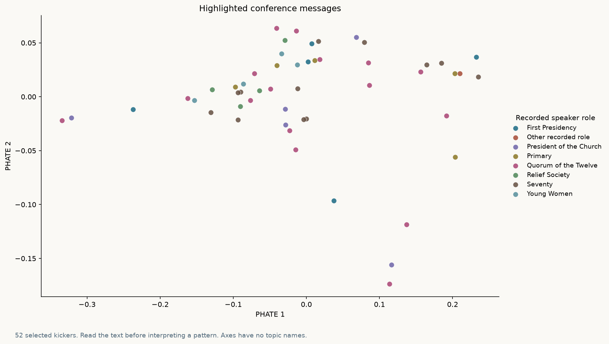

## Warm-up: what runs again?

Our script loads data, fits PHATE, creates a year filter, and draws a map.

A user changes the year filter.

1. Which statements execute again in the basic app?
2. Which computations actually need new results?

::: {.notes}
Two minutes. With no cache, all those statements execute again. The full-data map need not change because the user is only filtering displayed rows. Distinguish logical dependence from the framework's execution order.
:::

## Today's task

Help someone explore similar conference messages without editing a notebook.

We will build the interface, reuse expensive computations, and deploy the app through GitHub.

## The analysis we already know

| Step | Result |
|---|---|
| Read the teaching CSV | 52 messages and their metadata |
| Embed the kicker text | One 768-dimensional vector per message |
| Fit PHATE | Two plotting coordinates per message |
| Build a Plotly figure | An interactive view to guide reading |

Titles, speakers, and dates stay outside the model input.

## The map guides a closer reading

{height=440 fig-alt="PHATE scatterplot of 52 Nomic kicker embeddings, colored by recorded speaker role."}

The app connects this view to filters, summary counts, and the actual messages.

## Prepared outputs and a reproducible workflow

The project includes genuine saved Nomic embeddings.

Their artifact records the text, ordered talk IDs, model, and prefix.

Preparation code and provenance explain how to regenerate them. The hosted app can use them without running Ollama.

::: {.notes}
The supplied vectors use the official Nomic quantized ONNX export. data/embedding_provenance.json records the exact revision, hashes, backend, and pooling. The previous lesson used Ollama. These are genuine outputs of the same named model with a different inference backend, so exact vectors and PHATE layouts can differ. Import previous vectors using scripts/prepare_data.py if matching the previous map is important. Students do not need ONNX dependencies for the app.
:::

## Follow along: the first map

```bash
uv run streamlit run day2/01_map.py
```

Read the short file together:

- Load the table and saved vectors.
- Check that rows and texts match.
- Fit PHATE and add its coordinates.
- Display the familiar Plotly figure.

## Why alignment matters

```python
assert np.array_equal(
    saved["talk_id"], df["talk_id"].to_numpy(dtype=str)
)
assert np.array_equal(
    saved["kicker"], df["kicker"].to_numpy(dtype=str)
)
```

A vector must remain attached to the text that produced it.

Sorting only one file can create a plausible picture with incorrect labels.

## Meaningful filters

```python
years = st.multiselect(
    "Conference years", [2020, 2023, 2025],
    default=[2020, 2023, 2025],
)
shown = df.loc[df["year"].isin(years)]
```

Use `shown` for the map and its supporting records.

An empty selection means no years. Tell the reader how to recover.

## Metrics for the current view

With a partner, propose a useful summary.

What question does it answer? Does it describe the full sample or the filtered records?

Our starting choices:

- Talks displayed out of the full sample
- Unique speakers represented
- Distinct conferences represented

::: {.notes}
Two minutes. A conference is a year-month combination, not just a year. The full sample has 52 talks, 35 speakers, and 6 conferences. All numbers should update together. An average kicker length is defensible only when connected to a question about the represented text.
:::

## A summary row

```python
a, b, c = st.columns(3)
a.metric("Talks displayed", f"{len(shown)} / {len(df)}")
b.metric("Speakers represented", shown["speaker"].nunique())
c.metric("Conferences represented",
         shown[["year", "month"]].drop_duplicates().shape[0])
```

For 2025: **16 / 52 talks**, **16 speakers**, **2 conferences**.

## Filtering and refitting

Our app fits the full sample once, then filters the displayed rows.

The original coordinates, axis ranges, and color assignments remain stable.

Refitting PHATE on a subset would ask a different question and create a different map. Keep that as a separate analysis choice.

## Observation: an unrelated input feels slow

```bash
uv run streamlit run day2/02_filters.py
```

Watch the terminal while changing the year selection.

Why does **FITTING PHATE** appear again?

Which result could we reuse?

## A function call can reuse its result

```python
@st.cache_data
def compute_map(X, random_state=386):
    print("CACHE MISS: fitting PHATE")
    return phate.PHATE(
        random_state=random_state
    ).fit_transform(X)
```

The call still occurs on a rerun. A cache hit skips the function body and returns its saved result.

::: {.notes}
Source: https://docs.streamlit.io/develop/concepts/architecture/caching . The key includes function code and hashed input arguments. The decorator is a practical introduction to decorators, not a topic requiring a full Python metaprogramming detour.
:::

## Cache hit or cache miss?

| Change | Cached PHATE result? |
|---|---|
| Color points by another metadata field | Reuse |
| Filter which full-map points appear | Reuse |
| Supply different embedding vectors | Recompute |
| Change the random-state argument | Recompute |
| Clear this function's cache | Recompute on the next call |

Explain each answer using the function's inputs.

## A short cache experiment

```bash
uv run streamlit run day2/04_cache_lab.py
```

Predict, then try:

1. Select 2, then 3, then 2 again.
2. Change only the display preference.
3. Clear the cache and repeat.

The one-second delay is deliberately simulated. The result is ordinary arithmetic.

::: {.notes}
Use this for three minutes if PHATE is too fast to demonstrate timing clearly. It isolates caching from the statistical method. Do not imply the delay simulates actual measured inference time.
:::

## Caching the actual pipeline

| Work | Treatment |
|---|---|
| Load and validate saved data | `st.cache_data` |
| Compute the full PHATE map | `st.cache_data` |
| Apply cheap filters and summaries | Recalculate |
| Load a Python model or connection object | Often `st.cache_resource` |

Our deployed app loads embedding arrays. It does not load an embedding model.

## Cache, session, or saved artifact?

| Need | Mechanism |
|---|---|
| Reuse an expensive function result | Data cache |
| Reuse a model or connection object | Resource cache |
| Remember this user's additional choices | Session State |
| Keep model outputs across app restarts | Saved artifact |

By default, caches can serve multiple users. User-specific memory belongs in the appropriate session mechanism.

::: {.notes}
Source: https://docs.streamlit.io/develop/concepts/architecture/caching . Cached data returns copies. Cached resources normally share the same object and require care with mutation and concurrency. Scope configuration exists, but is outside this introduction. A cache is not a durable project data store.
:::

## Freshness is an input-design problem

Our finished loader receives the actual file contents:

```python
df, X = load_inputs(
    csv_path.read_bytes(),
    embedding_path.read_bytes(),
)
```

Changed contents produce a different cache key.

A cached function given only a filename will not automatically notice every change to that file.

## Live sources and local embeddings

For a changing external source, a lifetime can limit stale results:

```python
@st.cache_data(ttl=600)
def fetch_data(url):
    ...
```

After expiration, a subsequent call refreshes the result. This is not a scheduled data pipeline.

An optional local app caches a real embedding call by **text, model, and prefix**.

::: {.notes}
Only show day2/05_local_embedding.py if Ollama is prepared. The core hosted app never requires it. A Streamlit cache of returned vectors does not manage the Ollama server's loaded-model memory. Source: https://docs.ollama.com/api/embed .
:::

## Evidence behind the map

The completed app connects the visual view to:

- A selected kicker and its author
- An original source link
- Supporting records for the current filters
- An optional ranking using original-vector cosine similarity

Read messages before naming a theme. The 2D map can distort relationships.

## Deployment changes where Python runs

| Location | Role |
|---|---|
| GitHub repository | Stores code, data artifacts, and dependency definitions |
| Streamlit Community Cloud | Installs dependencies and runs Python |
| Reader's browser | Displays and interacts with the app |
| GitHub Pages | Hosts our static project website, which can link to the app |

::: {.notes}
Sources: https://docs.streamlit.io/develop/concepts/architecture/architecture and https://docs.streamlit.io/deploy/streamlit-community-cloud/deploy-your-app/deploy . Push the supplied small embedding artifact. Never push the local .venv directory or model weights.
:::

## The deployment workflow

1. Run `app.py` locally and check its filters.
2. Commit and push code, data, `pyproject.toml`, and `uv.lock`.
3. Open [share.streamlit.io](https://share.streamlit.io) and create an app.
4. Select the repository, branch, and `app.py`.
5. Choose Python 3.12, deploy, and inspect the logs.

Community Cloud recognizes `uv.lock`. Use the same environment definition locally and on the host.

::: {.notes}
Reserve 10-12 minutes. Sources: https://docs.streamlit.io/deploy/streamlit-community-cloud/deploy-your-app/app-dependencies and https://docs.streamlit.io/deploy/streamlit-community-cloud/deploy-your-app/deploy . The exact UI wording may change. Follow deployment.qmd. If accounts block a student, pair them with a deployed app and complete the task-based check.
:::

## A small update completes the loop

Change a useful label, commit, and push to the app's selected branch.

Check the deployed result and logs.

Ask a partner to answer the original question using only the interface.

Could they identify relevant messages and verify the source?

## Exit check

1. Why can changing a color reuse the PHATE result?
2. What distinguishes saved embeddings from a runtime cache?
3. Where does Python run after deployment?
4. Which interface choice made the analysis easier to use?

Keep the reproducible workflow visible in the repository and the reader's task clear in the app.
