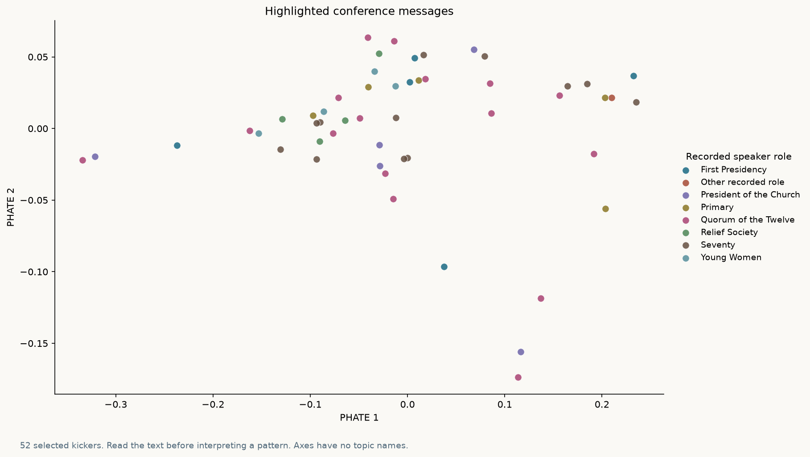

A reproducible analysis lets someone rerun your work. A dashboard lets someone explore that analysis and ask questions without editing Python.

## Two class meetings

| Meeting | Central question | Materials |
|---|---|---|
| Day 1 | What makes a dashboard useful, and how does Streamlit execute our code? | [Slides](day1_slides.qmd) ([PDF](reference/Day1_Dashboards.pdf)), `day1/01_basic.py`, `day1/02_execution.py` |
| Day 2 | How do we turn our text EDA into a responsive, shareable app? | [Slides](day2_slides.qmd) ([PDF](reference/Day2_Streamlit_App.pdf)), [follow along](demo.qmd), `day2/app_live.py`, completed `app.py` |

## Setup

Extract the complete project, open its root folder in Positron, and run:

```bash
uv sync
uv run streamlit run app.py
```

The completed app includes genuine precomputed Nomic embeddings. It does not require Ollama or an API key. The first map computation can take longer than later interactions.

{fig-alt="PHATE scatterplot of 52 kicker embeddings, colored by recorded speaker role." width="100%"}

The app adds filters, contextual counts, readable kickers, and source links around this analysis.

## What we are building

A person preparing a lesson can filter a sample of conference messages, inspect a map of their embeddings, read kickers, and open original talks. Summary counts explain which records support the current view.

The sample contains **52 selected kickers**, rather than full talk bodies or a representative sample of the entire archive. Each point represents the highlighted message before a talk. Read the original text before describing a theme.

## Other entry points

- [Step-by-step coding guide](demo.qmd)
- [Deployment through GitHub and Community Cloud](deployment.qmd)
- [Streamlit reference](cheatsheet.qmd) and [printable PDF](reference/Streamlit_Cheatsheet.pdf)
- [Student questions](activities/questions.qmd) and [practice notebook](activities/practice.ipynb)
- [Instructor timing, preparation, and suggested answers](instructor/guide.qmd)

## Rebuilding this website

Install the [Quarto CLI](https://quarto.org/docs/get-started/) separately, then run:

```bash
quarto preview
quarto render
```

Quarto writes the website and Reveal.js slides to `docs/`. It does not launch Streamlit or run the analysis. To publish the teaching website on GitHub Pages, choose **Deploy from a branch**, your branch, and **/docs**. Host the running Python app separately on Streamlit Community Cloud.
